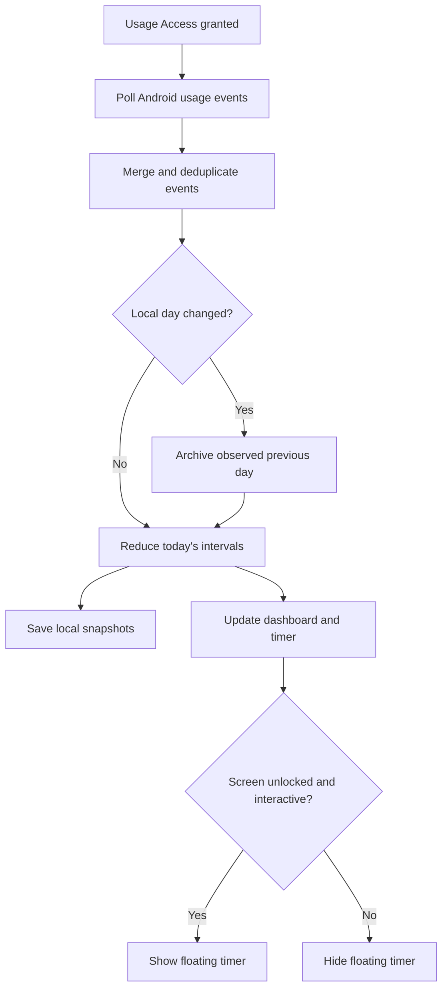

# BrainPal analysis and TimeLens implementation

Prepared 23 October 2026. Target: **BrainPal: Quit Scrolling / See Your Reel Count**, EpowerX Labs, Android package `com.brainrot.android`.

## What the evidence actually establishes

The supplied screenshot identifies the Play Store app; it contains no executable code. Its [official listing](https://play.google.com/store/apps/details?id=com.brainrot.android) says it counts reels/shorts across Instagram, YouTube, Facebook and Snapchat, presents a live count and a changing brain visual, and offers a limit/blocking feature. The listing explicitly says it uses Android's Accessibility Service API to detect scrolling in selected apps.

| Finding | Evidence status |
| --- | --- |
| Android package and publisher above | Verified from the official store listing |
| Accessibility Service is used for selected-app scroll detection | Explicit developer statement in the listing |
| Reel count is the main metric; limits/visual feedback use that count | Published product behavior |
| Specific Accessibility event types, resource IDs and deduplication rules | Unknown without APK/runtime evidence |
| Overlay WindowManager type and exact rendering mechanism | Unknown; a floating Android window is a plausible mechanism |
| Kotlin/Java/Flutter/React Native, Room/DataStore/SQLite, Firebase/backend design | Unknown; not established by a screenshot or product description |
| Accuracy of each platform's reel counter | Not independently measured |

The developer's accessibility disclosure is evidence of intended behavior, not a full source audit. No proprietary BrainPal code, graphics or branding have been copied into TimeLens.

## A plausible reel-counter design, clearly an inference

An Android implementation can observe accessibility window/content/scroll events, first filter the event's package, classify whether a short-video surface is visible, then count a transition to a new reel. Classification can use exposed view identifiers, node classes and content changes; multiple accessibility events can represent one swipe, so a counter needs deduplication and debouncing. Scrolling comments or a normal YouTube feed must be distinguished from changing a short. The count can update a floating visual, a local history and optional limit enforcement.

That explains a feasible architecture for the published behavior. It does **not** identify BrainPal's actual classes, algorithms, event handlers, native UI framework, storage or network stack. Those require its APK and preferably an observed test session.

## The requested app uses a different signal

Mohit's requirement is time spent per app and total screen time, visible above other apps. It does not require identifying individual reels or inspecting screen content. Android already supplies package activity events through [UsageStatsManager](https://developer.android.com/reference/android/app/usage/UsageStatsManager).

| Capability | BrainPal's published behavior | TimeLens implementation |
| --- | --- | --- |
| Metric | Reels/shorts consumed | Active foreground app duration |
| Scope | Selected short-video apps | Ordinary apps including browsers, social apps, Settings and TimeLens |
| Input | Accessibility-based scrolling detection | Usage Access / UsageEvents |
| On-screen feedback | Reel count and brain visual | Draggable pill with today's total and current app's daily total |
| History | Internal mechanism unverified | App-private SQLite |
| Enforcement | Published paid reel blocking | No app blocking in this version |
| Screen content | Exact access unknown | No accessibility or screen-content access |

The floating pill example is `TODAY 02:14:36` with `YouTube · 00:18:20` below it. The values are illustrative. The app's second line is its **accumulated usage today**, not just the current visit.

## Implemented architecture

TimeLens is a dependency-free native Java Android app, minimum API 29, compiled/targeted at API 35. There is no server or LLM in the counting path.

1. The user grants Usage Access and permission to display over other apps. Starting the overlay is an explicit action in the visible app.
2. `OverlayService` owns a persistent notification and requests usage refreshes on a background executor about every two seconds while the screen is on and unlocked. A main-thread tick refreshes the visible clock every second, with bounded interpolation between snapshots.
3. `UsageRepository` queries incrementally with a ten-second overlap and deduplicates event tuples. It merges retained events with a local event cache and owns date/timezone boundaries.
4. `UsageTimeline` sorts the event stream and reduces it to non-overlapping intervals. The most recently resumed package owns the current interval. A matching activity pause/stop closes it. Pauses from an older activity class do not close a newer class. Screen-off/lock events stop accumulation. Unlock/screen-on events do not backfill the locked gap.
5. Local midnight is computed with `LocalDate` and the device timezone; intervals are clipped to the relevant calendar day. Observed previous days are finalized before rollover. Shutdown/startup reset unfinished state rather than assigning reboot downtime to the previous app.
6. `UsageStore` atomically writes daily totals and package totals; the rolling raw-event cache makes replay repeatable across process restarts. Saves are throttled to approximately thirty seconds with additional lifecycle flushes.
7. `MainActivity` reads the same repository for Today, History and Settings. The floating pill is a `TYPE_APPLICATION_OVERLAY` window and uses a `specialUse` foreground service declaration for Android 14+.

The service uses `FOREGROUND_SERVICE` and `FOREGROUND_SERVICE_SPECIAL_USE`, with a descriptive service subtype. Android documents the declarations and Play review behavior in [Foreground service types](https://developer.android.com/develop/background-work/services/fgs/service-types#special-use). A store release still requires the appropriate release signing, current target policy checks and real-device verification; this deliverable is a personal debug build.

## Definition and accuracy boundaries

Total time is the sum of these non-overlapping app intervals. It excludes the launcher, System UI, lock screen and screen-off periods. It counts normal foreground apps even when they are not social-media apps. Audio running with the screen off does not count.

Android's `queryUsageStats` can expand a requested range to whole aggregation buckets. This implementation uses event intervals rather than summing those buckets as an exact local-day total. The [UsageStatsManager reference](https://developer.android.com/reference/android/app/usage/UsageStatsManager) also notes that raw events are kept only for a few days and can be unavailable before the user unlocks after boot. TimeLens cannot recover missing history that Android no longer exposes.

Multi-window and picture-in-picture are approximated using the latest resume event. UsageEvents does not provide an interaction-perfect global foreground-app feed; same-class overlapping instances, OEM event differences and delayed events can affect results. Its totals are not promised to equal Digital Wellbeing. Device-specific accuracy and battery cost remain unmeasured.

Some apps intentionally hide third-party overlays with Android's overlay protection. This is documented in [Android 12 features](https://developer.android.com/about/versions/12/features#app-overlay-controls). A normal app cannot promise visibility over every banking, permission or secure system screen.

## REA setup results

- Cloned `morluto/rea`; inspected repository commit `46111dd091f2ae01baab9eb119b53b9bd309a05b`.
- Installed the published npm `rea-agents@6.7.0`, whose CLI version command passes under Node 24.19.0 in this workspace. The repository's current engine requirements are stricter than the published package; the portable setup recommends a supported current Node 24.x release.
- Downloaded the official `jadx-headless-mcp-0.7.1-all.jar` and verified SHA-256 `6e5eacf500b64292bfb73c49797c1958f6ee44646e43e868039ae7feb573ff75` against REA's pinned metadata.
- Verified a real MCP initialize/`tools/list` exchange: REA 6.7.0 starts and advertises 207 tools, including package, class, method and reference analysis for Android.
- The setup/doctor path fails in this host because the installed Linux `ps` cannot complete REA's process-ownership inspection (`fatal library error, lookup self`). This has not been bypassed or represented as a passing JADX analysis.
- No BrainPal APK was provided. No APK was pulled from the user's phone, and no BrainPal decompilation or runtime inspection occurred.
- The live ChatGPT Work session has not been connected to a newly installed local MCP registration. The portable script performs the supported client setup on the user's development machine.

These results distinguish an installed and launchable CLI/MCP server from a working Android analysis provider and a completed target investigation. See [REA Android analysis](https://github.com/morluto/rea/blob/main/docs/android-analysis.md) and [installation](https://github.com/morluto/rea/blob/main/docs/installation.md).

## Completing the actual BrainPal investigation

On a developer computer with ADB and your phone's authorized USB-debugging connection, run `scripts/export-brainpal.sh`. It uses `pm path com.brainrot.android` and exports the base APK and any installed split APKs. The Play Store screenshot alone cannot replace these files.

With the exported APK, a working REA/JADX host can:

1. Record artifact hashes/version/signers and inspect the decoded manifest.
2. Identify the declared accessibility service and any overlay/foreground-service declarations.
3. Inspect its actual `onAccessibilityEvent` handler, package filters and reel-surface classifiers.
4. Trace counter updates, duplicate filtering, overlay rendering, storage and reset boundaries.
5. Compare those static findings with one-reel, repeated-scroll, comments, app-switch and lock/unlock tests on the phone.

Until that evidence exists, the speculative reel-counter architecture above should remain labelled as an inference.

## Validation and handoff

The SDK-only build compiled all sources against the public Android 35 API, linked resources, produced DEX and signed an installable-form APK. Signature verification and binary manifest inspection passed. The reducer passes 23 assertions including a randomized no-double-counting bound.

The Android Gradle dependency path could not resolve artifacts because this host's Java networking could not reach its configured proxy; it was not used to assert a passing build. A standard Gradle project is included for Android Studio, and the verified SDK-only build script is supplied as an alternative.

No Android emulator or attached phone was available. The following device checks remain: first launch, permission return flow, overlay drag/tap, app-switch latency, a timed YouTube/Instagram/browser session, screen-off exclusion, local midnight, Samsung battery handling, service restart and reboot reminder. This is a testable implementation and research report, not a claim of completed on-device QA.
